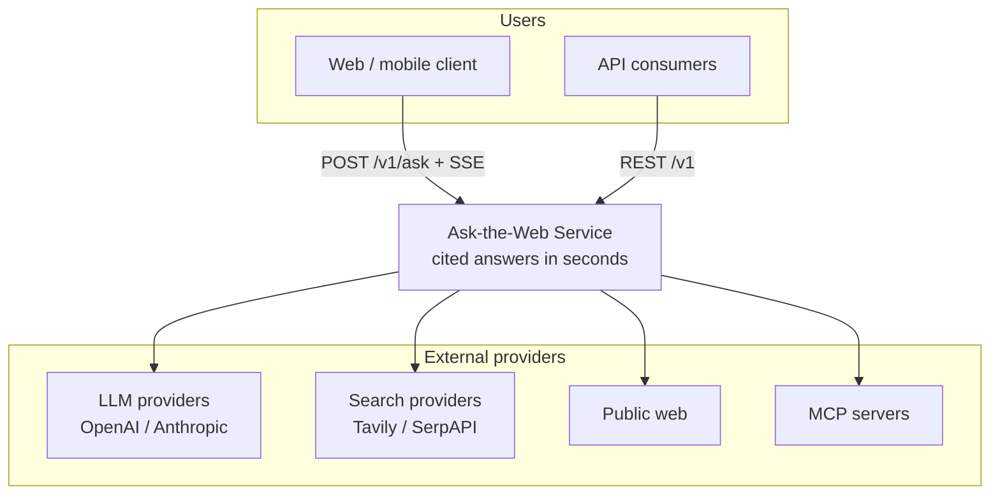
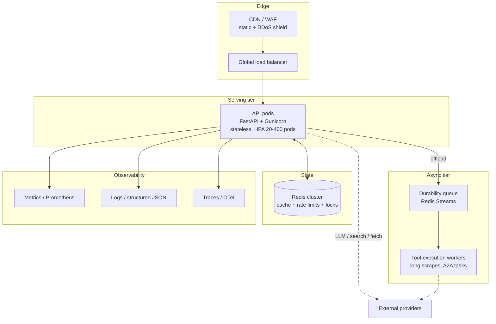

# System Architecture

**Status:** Active · **Version:** 2.0 · **Last updated:** 2026-10-16

This document describes the production architecture of Ask-the-Web — a
Perplexity-style, cite-grounded answer service — designed to serve
**100–200M daily active users** with graceful degradation instead of hard
failure. The companion documents are the authority on their areas:

- Sizing math & unit economics → `docs/architecture/capacity-planning.md`
- Where it breaks and why → `docs/architecture/failure-mode-analysis.md`
- One request, end to end → `docs/architecture/request-lifecycle.md`
- Decision records → `docs/architecture/adr/`

---

## 1. Product Context (C4 Level 1)



The service is a **read-heavy, fan-out orchestrator**: one user question
becomes 4–10 internal steps and 3–6 external calls before an answer streams
back. Every architectural choice below optimizes for that shape: cache hard,
budget everything, degrade in tiers.

## 2. Container View (C4 Level 2)



### Tier responsibilities

| Tier | Responsibility | Scaling unit |
| ---- | -------------- | ------------ |
| Edge | TLS, WAF, static, DDoS | provider-managed |
| API (`api/`) | Auth, rate limit, cache, agent orchestration, SSE | pods, CPU + in-flight requests |
| Async (`tools/`, A2A) | Scrapes > 5s, remote-agent tasks, MCP fan-out | workers, queue depth |
| State (Redis) | Response cache, rate limits, singleflight locks, A2A task store | cluster, memory |
| Observability | RED metrics, structured logs, traces with request IDs | central platform |

**The API tier stays stateless and fast.** Anything that can exceed a 5-second
budget — Playwright renders, slow remote agents, deep scrapes — is pushed to
the async tier through Redis Streams so HTTP workers never block on a slow
third party.

## 3. Component Map (C4 Level 3 — codebase)

| Package | Role | Critical invariant |
| ------- | ---- | ------------------ |
| `core/` | LLM client, budgets, resilience (retry/CB/token-bucket), usage & cost tracking, message types | Every LLM/tool call passes a budget check first |
| `tools/` | Tool contracts, registry, executor, pooled HTTP, SSRF guard, web tools, MCP client/server | No outbound URL escapes the SSRF guard |
| `workflows/` | Deterministic patterns: chaining, routing, parallelization (sectioning/voting), reflection, orchestrator-worker | Workflows are composable and bounded |
| `agents/` | Reasoning strategies: ReACT, Reflexion, ReWOO, tree search, planner, A2A multi-agent | All loops terminate via budget or max-iterations |
| `api/` | HTTP surface: routes, middleware, cache, SSE streaming, DI, health | Degraded dependencies never take down `/healthz` |
| `evaluation/` | Golden-set QA, citation metrics, CI quality gate | Answer quality is a build artifact, not a vibe |
| `configs/` | Settings, logging, Prometheus scrape config | Secrets are `SecretStr`, never logged |

## 4. Key Architectural Principles

1. **Budget before execute.** Every request carries a `BudgetManager`
   (tokens, tool calls, steps, wall-clock). Runaway agents return
   `BudgetExceededError` → structured HTTP responses, never a hang.
2. **Degrade in tiers, not cliffs.** Provider order: primary → fallback →
   degraded mode (answer from cache/snippets with a disclosure line).
   Circuit breakers per provider stop retry storms from amplifying an outage.
3. **Cache is a feature.** Two layers — L1 in-process (µs, per-pod) and L2
   Redis (ms, global) — with singleflight locks so a hot uncached query
   triggers exactly one upstream computation (no stampede) and
   stale-while-revalidate so popular answers never block on refresh.
4. **Treat the LLM as untrusted input.** Tool arguments produced by the model
   are validated against JSON schemas and SSRF-checked before execution.
5. **Cost is a first-class metric.** Per-request USD accounting
   (`core/usage_tracker.py`) feeds dashboards and per-tenant quotas.

## 5. Availability & SLOs

| SLO | Target | Notes |
| --- | ------ | ----- |
| Availability (ask API) | 99.9% monthly | Multi-AZ; multi-region for 2.0 |
| Answer latency p50 / p95 | 2.5s / 8s to first byte (SSE) | Measured at edge |
| Cache hit ratio | ≥ 35% steady-state | Doubles effective LLM capacity |
| Degrade-not-fail | 100% of provider outages | Answer quality drops, 200s continue |

Error budget policy: at 2× budget burn, freeze feature deploys; at 4×, roll
back to the last green release tag.

## 6. Scale Path (what changes at each order of magnitude)

- **0–1M DAU:** single region, 20–60 API pods, Redis primary+replica,
  single LLM provider contract with fallback configured.
- **1–10M DAU:** dedicated async worker pools, Redis Cluster (3 masters),
  per-provider circuit breakers tuned from real error rates, regional cache
  warming for trending queries.
- **10–100M+ DAU:** active-active regions with geo-routing, query
  deduplication across regions (global singleflight), provider quota
  market-making across multiple LLM/search vendors, semantic cache layer
  (embedding near-duplicates) — tracked in the 2.x roadmap.

The codebase encodes these seams today: `api/dependencies.py` centralizes
wiring, `core/llm_client.py` is provider-pluggable, and `api/cache.py`
versions its keys (`ask_web:v2:…`) so a cache-layer swap is a rollout, not a
rewrite.

## 7. Repository Layout

```
Ask-the-Web-103/
├── agents/            # ReACT, Reflexion, ReWOO, tree search, planner, A2A
├── api/               # FastAPI: routes, middleware, cache, streaming, DI
├── configs/           # settings, logging, prometheus, gunicorn
├── core/              # LLM client, budgets, resilience, usage, types
├── deploy/k8s/        # manifests: deployment, HPA, PDB, configmap
├── docs/              # this documentation tree
├── evaluation/        # metrics, evaluator, benchmarks, golden datasets
├── tests/             # unit + integration + resilience suites
├── tools/             # registry, executor, web tools, SSRF guard, MCP
└── workflows/         # chaining, routing, parallelization, reflection, O-W
```
