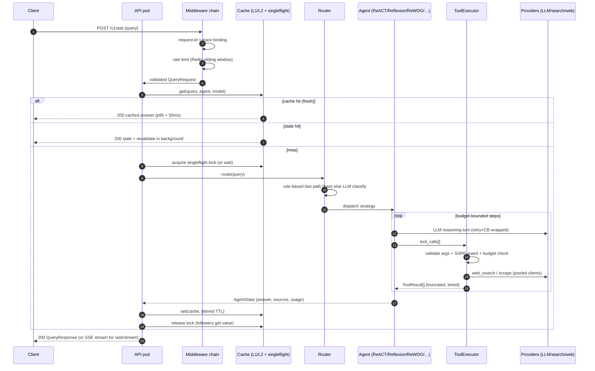

# Request Lifecycle — one question, end to end

**Status:** Active · **Last updated:** 2026-10-16

This traces a single `POST /v1/ask` through every layer, with the failure
branch at each hop. Latencies are p95 targets at peak load.

## Stage-by-stage contracts

### 1. Edge → middleware (target: < 2 ms added)
- `RequestIDMiddleware` binds `request_id` into structlog contextvars —
  every subsequent log line and trace span carries it.
- Rate limiting is **Redis-backed** so limits are global across pods;
  `/healthz`, `/readyz`, `/metrics` bypass it.
- On 429 the response includes `Retry-After` — clients back off instead of
  hammering (FM-03 prevention).

### 2. Cache layer (hit path p95 < 50 ms)
- Key: `ask_web:v2:sha256(query|agent|model)` — normalized query.
- **Fresh hit** → immediate return, `cached: true`.
- **Stale hit** → serve stale, refresh in background (SWR).
- **Miss** → acquire per-key lock via Redis `SET NX PX`; one pod computes,
  others block briefly then read the value. This is the FM-04 defense.

### 3. Routing (target: < 400 ms, free when rule-based)
- `QueryClassifier.quick_classify` — keyword rules, zero cost, catches
  conversational/calculation patterns.
- LLM fallback classification, cached per normalized query for 10 minutes
  (routing decisions are stable; don't pay twice).

### 4. Agent execution (target: p95 < 6 s compute)
- Every agent inherits the same guarantees: system prompt, iteration cap,
  context trimming, budget object threaded through each step.
- Before **every** LLM call: `budget.consume_tokens(estimate)`; before
  **every** tool call: `budget.consume_tool()`. Exhausted budget → clean
  `BudgetExceededError`, surfaced as HTTP 422 with a best-effort partial
  answer in `metadata.partial`.

### 5. Tool execution (per-call timeout ≤ 15 s)
- JSON-schema validation of LLM-produced arguments (the model is untrusted).
- SSRF guard on all URLs (FM-08) and byte caps on bodies (FM-09).
- Parallel calls via `asyncio.gather` bounded by a semaphore; each call
  wrapped in `wait_for(timeout)`.
- Results truncated to a budget-aware size before entering context.

### 6. Response & observability
- Usage (tokens, USD, tools, latency) recorded per request via
  `core/usage_tracker.py` → Prometheus histograms + log event.
- Slow/failure paths emit distinct counters, so each FM row has a direct
  dashboard query.

## Failure branch summary

| Hop fails | User sees | Internal behavior |
| --------- | --------- | ----------------- |
| Rate limit | 429 + Retry-After | counter `rate_limited_total` |
| Redis down | slower answers | cache/locks fail-open, in-memory limits |
| Router LLM fails | still routed | keyword default → `simple_qa` |
| Search provider fails | snippet-grounded answer or disclosure | CB opens, secondary tried, degraded flag set |
| All LLM providers fail | 503 + cached answer if any | CBs open, ops paged (FM-01) |
| Budget exceeded | 422 + partial answer | `budget_exceeded_total` |
| Tool timeout | answer notes missing source | per-call timeout, FM-09/FM-11 |
